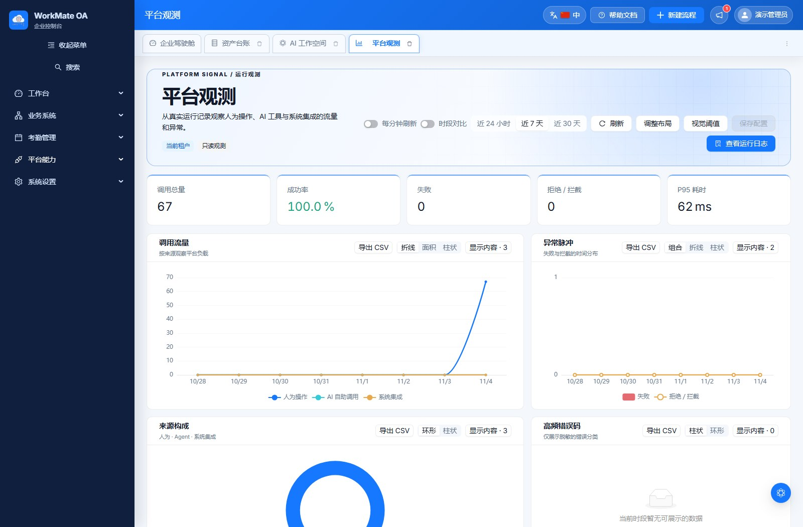
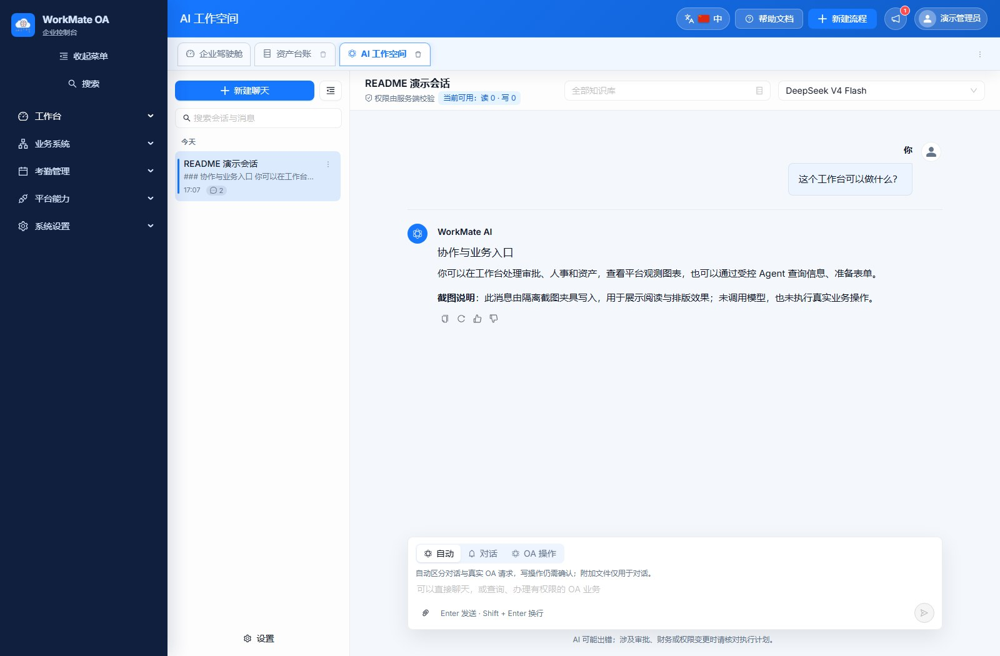
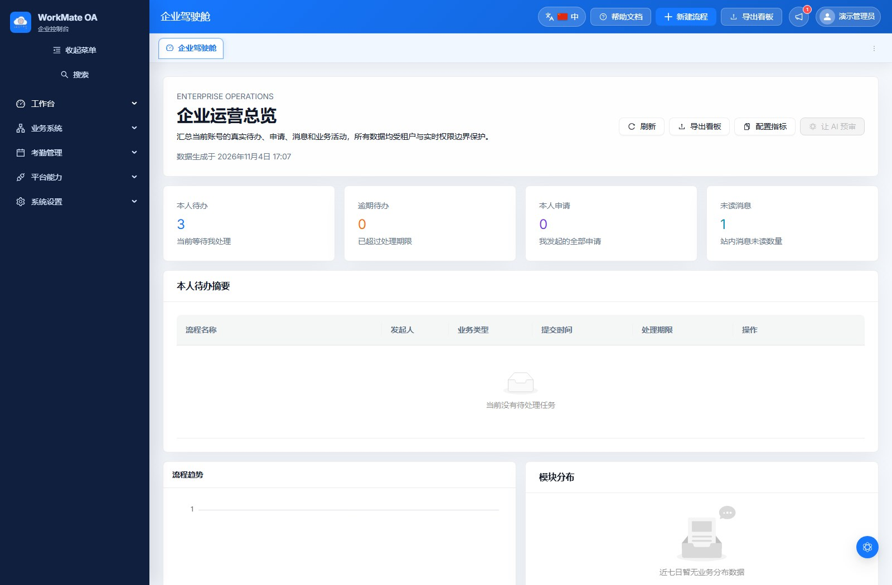
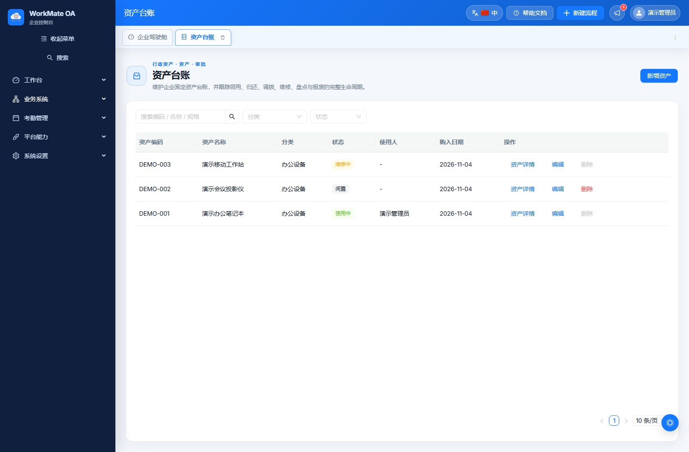

# AI WorkMate

[](https://github.com/MewzCC/ai-workmate/actions/workflows/phase-1-ci.yml)

**企业 OA 工作台、AI 对话与受控 Agent 执行平台。**

在同一个工作台中处理审批、人事、资产和考勤，管理知识库，通过 AI 查询业务信息、准备表单及执行经过授权的单步写操作。项目包含两个独立前端和一个 Spring Boot 模块化单体，支持本地开发与 Docker Compose 部署。

[界面预览](#界面预览) · [业务能力](#业务能力) · [快速开始](#快速开始) · [测试与-ci](#测试与-ci) · [文档](#文档)

> 当前代码包含 **42 个 OA 页面组件、152 个 Agent 工具定义（50 读 / 102 写）**。登记、配置启用、用户授权和业务验收是不同状态；实际可用能力以服务端配置与实时权限为准。项目仍在迭代，待验收范围见[问题基线](docs/roadmap/oa-agent-issue-baseline-20261026.md)。

## 界面预览

以下为真实运行页面截图。OA 使用一次性隔离 PostgreSQL / Redis 环境和合成演示账号；资产、通知及会话内容仅用于展示，不包含真实用户资料。AI 截图中的示例答复由夹具写入，不代表真实模型调用或业务执行。

### 平台观测看板



<details>
<summary><strong>AI 工作空间：会话与消息阅读</strong></summary>



</details>

<details>
<summary><strong>企业驾驶舱：业务指标与工作入口</strong></summary>



</details>

<details>
<summary><strong>资产台账：状态、保管人与业务操作</strong></summary>



</details>

<details>
<summary><strong>独立营销官网</strong></summary>


</details>

## 业务能力

| 领域 | 当前代码提供的能力 |
| --- | --- |
| 身份与权限 | 密码及验证码登录、注册、密码重置、JWT Cookie、实时数据库 RBAC、租户与数据范围、动态菜单 |
| 工作台与观测 | 驾驶舱、我的待办、消息中心、平台观测、ECharts 多类型图表、指标与布局偏好 |
| 流程审批 | 草稿、提交、撤回、重新提交、顺序审批、转交、抄送、加签、催办、定义快照与审计时间线 |
| 组织人事 | 组织架构、员工档案、任职历史、档案附件、入职 / 转正 / 调岗 / 离职流程 |
| 行政资产 | 资产领用、归还、调拨、维修、盘点、报废；会议预约与冲突检测；访客签到离场；用印与归还 |
| 财务合同 | 费用报销、预算、合同与供应商专属页面及相应业务接口 |
| 考勤 | 打卡、异常考勤、补卡申请、月度统计、考勤设置 |
| AI 与知识库 | 独立聊天工作空间、SSE 流式消息、服务端会话持久化、附件、文档解析、向量与全文检索、引用 |
| 管理与配置 | 角色权限、页面操作、数据权限、AI 工具权限、审计、租户、字典、系统配置 |
| 界面体验 | 中英文、桌面与移动端、访问页签、明暗主题、自定义壁纸、持续保留的侧边 AI 面板 |

页面使用真实接口；依赖未配置或接口失败时展示错误及不可用状态。上表描述代码覆盖范围，逐项交付与限制见[全页面工具清单](docs/roadmap/all-page-agent-tool-delivery.md)和[阶段收尾记录](docs/roadmap/batches/20261104-worktree-closeout.md)。

### Agent 如何执行业务

```text
用户请求 → 计划与冻结快照 → 风险及确认策略 → Worker 领取任务
         → Tool Gateway 重新鉴权 → 类型化领域 Port / Adapter
         → 领域服务校验与事务 → 审计、结构化回执、结果文字及受控导航
```

- 所有 Agent 工具调用经过进程内 **Tool Gateway**；Planner、Controller 和 Worker 不能直接调用 Handler。
- 网关复核租户、用户、实时权限、租约、版本与参数哈希、确认、预算和 Kill Switch；领域服务再次检查资源归属、状态与乐观锁。
- 一个任务最多一个写步骤，写工具受全局、租户和工具策略共同约束，并按风险要求确认。
- 页面交互指令只允许代码白名单内的导航、筛选、详情、填表、预览和刷新；准备表单不等于提交业务。
- 禁止任意 SQL、代码执行、文件系统、任意 URL、权限修改、删除、批量操作、敏感导出、外部消息和后台自治。

Agent 的环境变量默认关闭：

```dotenv
AGENT_ENABLED=false
AGENT_PLANNING_ENABLED=false
AGENT_EXECUTION_ENABLED=false
AGENT_WRITE_TOOLS_ENABLED=false
```

开启环境开关不等于获得业务权限或完成写能力发布。启用方式及边界见 [Phase 2 安全规范](docs/roadmap/phase-2-agent-security-boundary.md)与 [Tool Gateway 架构](docs/architecture/agent-tool-gateway.md)。API Key 和模型网关地址仅由服务端配置。

## 架构与技术栈

| 部分 | 目录 / 技术 | 默认地址 |
| --- | --- | --- |
| 营销官网 | `fronted-main` · Vite 5 / React 18 / TypeScript | <http://localhost:3000> |
| OA 工作台 | `fonted-oa` · Vite 5 / React 19 / React Router / Ant Design / ECharts / G6 | <http://localhost:3001/oa/> |
| 后端 | `backend` · Java 17 / Spring Boot 3.3 / Spring AI / Spring Security / MyBatis-Plus | <http://localhost:8080> |
| 数据与缓存 | PostgreSQL 16 / pgvector / Flyway / Redis 7 | `5432` / `6379` |
| 对象存储 | MinIO | API `9000` / Console `9001` |
| 可选服务 | Embedding / Rerank / PaddleOCR / SMTP | 按服务端配置 |

官网和 OA **独立运行、独立构建**。官网入口进入 OA 的 `/oa/`；OA 根路径 `/` 重定向到 `/oa`。仓库目录名 `fronted-main`、`fonted-oa` 沿用既有拼写，旧 `frontend` 不再作为应用边界。

后端当前以模块化单体运行，领域服务、工具 Port / Adapter、执行网关分别组织；尚未作为 Spring Cloud 微服务部署。

```text
ai-workmate/
├── fronted-main/             # 独立营销官网
├── fonted-oa/                # 独立 OA 工作台
├── backend/
│   └── src/main/
│       ├── java/com/aiworkmate/  # API、领域服务、认证、Agent
│       └── resources/db/migration/  # Flyway 迁移
├── docker/ocr-service/       # 可选 OCR 服务
├── docs/                    # 架构、规则、验收、截图
├── scripts/                 # 部署与验证脚本
├── .github/workflows/       # 前后端与浏览器 CI
└── docker-compose.yml
```

[查看交互式系统架构图](docs/architecture/ai-workmate-system-architecture.html)

## 快速开始

### 1. 准备环境与配置

需要 **Java 17、Maven 3.9+、Node.js 20+、npm**。基础设施推荐使用 Docker Compose：PostgreSQL 必须支持 pgvector，文件能力需要 MinIO。

首次运行，复制配置模板并填写本地配置：

```bash
cp .env.example .env
```

PowerShell 使用 `Copy-Item .env.example .env`。检查 `DB_*`、`REDIS_*`、`JWT_SECRET` 和 `MINIO_*`；JWT 密钥使用至少 32 字节的随机值。AI 对话、知识库、邮件及 OCR 分别需要对应外部服务配置，未配置时相应能力不可用。

完整变量见 [.env.example](.env.example)。不要提交真实 `.env`、账号、密钥、Token 或生产连接信息。

### 2. 启动基础设施与后端

在仓库根目录执行：

```bash
docker compose up -d postgres redis minio
```

后端终端：

```bash
cd backend
mvn spring-boot:run
```

默认 `dev` 配置连接本地 `ai_workmate_dev`。后端会自动执行 Flyway 迁移；新环境无需手工运行历史 `init.sql`。

### 3. 启动两个前端

官网终端：

```bash
cd fronted-main
npm ci
npm run dev
```

OA 终端：

```bash
cd fonted-oa
npm ci
npm run dev
```

访问 <http://localhost:3000> 或 <http://localhost:3001/oa/>。Windows 多终端启动脚本见 [start.bat](start.bat)。

### 4. 确认服务可访问

```bash
curl http://localhost:8080/api/system/health
curl http://localhost:3001/api/system/health
```

两者应返回成功响应，第二条同时检查 OA 的 API 代理。健康接口表示应用可响应；登录后的业务接口和外部模型、存储服务仍需分别验证。

### Docker 全栈部署

```bash
cp .env.docker.example .env.docker
# 编辑 .env.docker，替换占位配置后启动
docker compose --env-file .env.docker up -d --build
```

必须传入 `--env-file .env.docker`，以便正确注入后端配置及 `VITE_OA_URL` 等构建变量。支持独立端口、同域 `/oa/` 反代或独立 OA 域名。生产环境需要 HTTPS、随机密钥及安全 Cookie 配置。

可选 OCR：

```bash
docker compose --env-file .env.docker --profile ocr up -d --build
```

本地 OCR 安装与配置见 [OCR 聊天处理链路](docs/architecture/ocr-chat-pipeline.md)及 [安装脚本](scripts/install-ocr.ps1)。

## 测试与 CI

[Phase 1 CI](.github/workflows/phase-1-ci.yml) 在 Push、Pull Request 和手动触发时运行：

| 任务 | 验证内容 |
| --- | --- |
| `backend` | 初始化脚本幂等性、Java 测试、真实 PostgreSQL / 原生 Redis 隔离测试、迁移与安全边界 |
| `frontends` | 官网 lint / build，OA Vitest / lint / build |
| `phase-1-e2e` | 安装 Chromium，真实请假审批闭环、42 页异常态、空态、权限变化与四种分辨率 |

**2026-11-04 验证基线：**提交 `c4f40ffc` 的[云端流水线全部通过](https://github.com/MewzCC/ai-workmate/actions/runs/41798090422)。后端 2127 项、零失败、零错误、1 项跳过；E2E 50 项全部通过。后端跳过的是旧初始化脚本的 Testcontainers 用例；流水线另以 `psql` 连续执行两次该脚本检查幂等性。这些数字仅对应该提交，不代表所有外部服务或生产场景已验收。

前端本地检查：

```bash
cd fronted-main
npm ci
npm run lint
npm run build

cd ../fonted-oa
npm ci
npm run lint
npm test
npm run build
npx playwright install chromium
npm run test:e2e
```

真实请假 E2E 需要隔离测试账号及环境变量，配置见工作流；未提供账号时，该业务用例会明确跳过。页面接口失败场景使用测试夹具，不应计作真实业务写入验收。

后端隔离测试需要先设置下列环境变量，再在 `backend` 执行 `mvn test`：

| 变量 | 要求 |
| --- | --- |
| `AGENT_TEST_DB_URL` | 本地 PostgreSQL 控制库，例如 `jdbc:postgresql://127.0.0.1:5432/postgres` |
| `AGENT_TEST_DB_USERNAME` / `AGENT_TEST_DB_PASSWORD` | 本地测试凭据，账号需能创建、清理测试数据库 |
| `AGENT_TEST_REDIS_BINARY` | 本机 `redis-server` 可执行文件的绝对路径 |

夹具创建一次性数据库和独立 Redis 子进程，完成后清理自有资源。缺少必需环境时不得用跳过或 Mock 代替集成验收；CI 中的具体配置可直接参考工作流。

### 数据库变更约定

- Schema 与种子数据仅通过 `backend/src/main/resources/db/migration` 中的新 Flyway 迁移变更。
- 新版本使用 `VYYYYMMDDHHMM__description.sql`；已执行迁移不改名、不改内容、不删除历史。
- 升级检查包含空库、既有库、`validate`、重复启动与零待执行迁移。
- `db/init.sql` 是历史参考与 CI 幂等性检查入口，不是部署时的 Schema 管理入口。

## 配置与当前限制

- AI、Embedding、Rerank、MinIO、SMTP、OCR 的可用性取决于实际服务及配置。已配置不等于已完成真实推理、上传下载或邮件投递验收。
- 不提供固定演示登录账号；截图账号仅存在于一次性测试库中。
- Agent 工具目录不是所有页面读写的完成度证明；部分写工具默认禁用，运行发布需要独立验收。
- 前端构建仍可能提示较大的资源分块；页面可进入不等于全部控件与移动端组合均已完成业务验收。
- 对象文件与数据库元数据分别保存在 MinIO 和 PostgreSQL；数据库回滚不会同步恢复对象文件。

## 文档

| 主题 | 入口 |
| --- | --- |
| 工程与协作 | [AGENTS.md](AGENTS.md) · [工程规范](docs/rules/engineering-rules.md) · [Git 规范](docs/rules/git-rules.md) |
| 认证与权限 | [企业认证架构](docs/architecture/enterprise-auth.md) |
| 聊天与知识库 | [AI Workspace](docs/architecture/ai-chat-workspace.md) · [Embedding / pgvector](docs/architecture/embedding-pgvector.md) · [OCR](docs/architecture/ocr-chat-pipeline.md) |
| Agent | [安全边界](docs/roadmap/phase-2-agent-security-boundary.md) · [Tool Gateway](docs/architecture/agent-tool-gateway.md) · [任务引擎](docs/architecture/agent-task-engine.md) |
| 交付与后续验收 | [工具清单](docs/roadmap/all-page-agent-tool-delivery.md) · [问题基线](docs/roadmap/oa-agent-issue-baseline-20261026.md) · [收尾记录](docs/roadmap/batches/20261104-worktree-closeout.md) |
| 截图来源 | [截图说明](docs/images/readme/README.md) |
